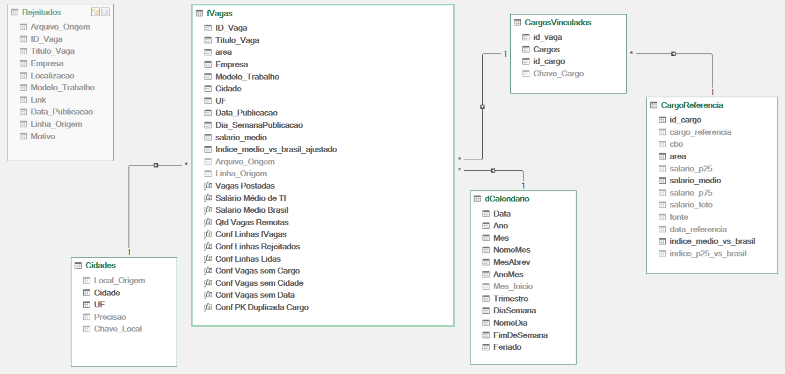

# Modelo relacional -- VagaRadar_03_PowerPivot.xlsx

Origem dos dados: 02-powerquery/VagasRadar_02_PowerQuery.xlsx (parâmetro pArquivoEtapa2). Nenhum dado é digitado nesta etapa.

## Tabelas

| Tabela | Tipo | Grão (1 linha =) | Chave primária | Linhas |
|---|---|---|---|---|
| fVagas | fato | vaga publicada | ID_Vaga | 1523 |
| CargoReferencia | dimensão | cargo de referência | id_cargo | 17 |
| CargosVinculados | dimensão | cargos vinculados | id_Vaga | 1501 |
| Cidades | dimensão | cidade / UF | Cidade | 25 |
| dCalendario | dimensão | dia (01/01 a 31/12/2026) | Data | 365 |
| Rejeitados | auditoria | linha bruta descartada | -- | 161 |

## Relacionamentos (todos ativos, N:1, filtro em direção única)

| # | Lado N (FK) | Lado 1 (PK) |
|---|---|---|
| R1 | fVagas[ID_Vaga] | CargosVinculados[id_vaga] |
| R2 | fVagas[Cidade] | Cidades[Cidade] |
| R3 | fVagas[Data_Publicacao] | dCalendario[Data] |
| R4 | CargosVinculados[id_cargo] | CargoReferencia[id_cargo] |

dCalendario marcada como Tabela de Datas (coluna Data).

